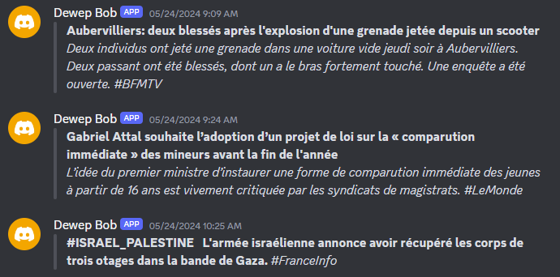

# News-Alerts-Discord

Send news live direct alerts to a Discord channel.

Every 15 minutes, articles are collected from the sources below, then filtered by Claude Haiku
(`claude-haiku-5-5`) to only keep the essential/important ones (few per day, less sport, more tech).
Each published message ends with the importance score given by the filter (e.g. `(7/10)`).

- FranceInfo (general news, curated headlines, heavily AFP-sourced) https://www.franceinfo.fr/titres.rss
- LeMonde Pixels (tech) https://www.lemonde.fr/pixels/rss_full.xml

Le Figaro Flash Actu would be a richer general wire but lefigaro.fr blocks datacenter IPs
(Datadome bot challenge).

Adding a source is a one-line entry in the `providers` list (any RSS 2.0 feed).
Articles older than 12 hours are ignored, so a fresh start (no `handled-news.json`)
or a long downtime does not flood the channel with the whole feed backlog.

You can also **ask follow-up questions** about a published news item by mentioning the
bot in the channel — see [Asking questions](#asking-questions-about-a-news-item).



## Discord BOT

- Create a Discord Application: https://discord.com/developers/applications
- Generate a Bot for this application (use the token for the DISCORD_BOT_AUTHORIZATION env variable)
- Add your bot to your Discord server: https://discord.com/oauth2/authorize?client_id=xxxx&scope=bot&permissions=2048 (xxxx is your app ID)
- The Discord Channel ID is the second part of the URL: https://discord.com/channels/xxxx/yyyy (yyyy here)

## Configuration

Secrets and settings are read from a `.env` file next to `docker-compose.yml`
(this file is gitignored). Create it with:

```
DISCORD_CHANNEL_ID=123456789
DISCORD_BOT_AUTHORIZATION=xxx.yyy.zzz
ANTHROPIC_API_KEY=sk-ant-...
```

- `DISCORD_CHANNEL_ID` / `DISCORD_BOT_AUTHORIZATION`: see the Discord BOT section above.
- `ANTHROPIC_API_KEY`: from https://platform.claude.com/ — used for the news filtering
  (Claude Haiku) and for the Q&A bot.

## Usage

For the first run, exec `zx --install main.mjs` to install dependencies.

```bash
DISCORD_CHANNEL_ID=123456789 DISCORD_BOT_AUTHORIZATION=xxx.yyy.zzz ANTHROPIC_API_KEY=sk-ant-... zx main.mjs
```

To test the collection + filtering without sending anything to Discord (and without
persisting state):

```bash
ANTHROPIC_API_KEY=sk-ant-... zx main.mjs --dry-run
```

Handled article IDs are persisted in `handled-news.json` so a restart does not re-send
already-processed news.

## Tuning the filter

Each article gets an importance score from 0 to 10; only articles scoring at or above the
threshold are published. The default threshold is 6 (a handful of news per day). Set
`NEWS_IMPORTANCE_THRESHOLD=7` for fewer news, `8` for major events only.

The titles published over the last 48 hours are given back to the filter so the same event
coming later from another source is not published twice.

The filter model defaults to `claude-haiku-5-5` (10x cheaper than Haiku 4.5) and can be
changed with `NEWS_FILTER_MODEL` (any Anthropic model ID, e.g. `claude-sonnet-5-5`).

## Asking questions about a news item

A second service (`bot.mjs`) connects to the Discord **gateway** — an outbound
WebSocket, so there is nothing to expose and no inbound port to listen on. It answers
questions about a published news item when the bot is **mentioned**, e.g.
`@NewsBot where does this number come from?`

The bot only reacts to a mention: simply replying to one of its messages does **not**
trigger an answer, so members can debate the news among themselves. To give the question
its news context, mention the bot *in a reply* to the alert (or to a previous answer) —
the article (title, summary, link) is then read from `handled-news.json`. The answer is
written by Claude using Anthropic's server-side `web_search` and `web_fetch` tools, so it
can look things up and cite sources.

Setup:

- Enable the **Message Content** privileged intent for your bot
  (Discord Developer Portal → your app → Bot → Privileged Gateway Intents). Without it,
  Discord still delivers the content of mentions and replies to the bot, but enabling it
  is recommended.
- No extra Discord permission is required (the bot already needs *Send Messages*).
- Run the `news-alerts-bot` service (see [Docker](#docker)), or locally:

  ```bash
  DISCORD_CHANNEL_ID=123456789 DISCORD_BOT_AUTHORIZATION=xxx.yyy.zzz ANTHROPIC_API_KEY=sk-ant-... zx bot.mjs
  ```

Notes:

- Answers are capped at ~1900 characters and split over several messages if longer.
- The news context is only kept 48h (same retention as `handled-news.json`); after that
  the bot falls back to the raw quoted message.
- `NEWS_ANSWER_MODEL` selects the answering model (default `claude-haiku-5-5`); a Sonnet
  model answers better at a higher cost.
- Already-answered question IDs are persisted in `answered-questions.json` so a restart
  does not answer them twice.

## Docker

This starts two services: the news poller and the Q&A bot. Each gets its own
`node_modules` volume so the two `zx --install` runs at boot never clash.

```
git pull
docker compose stop
docker compose rm
docker compose build
docker compose up -d
```
